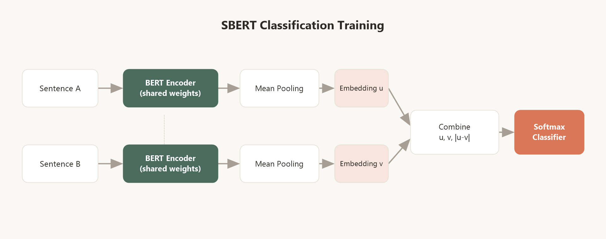
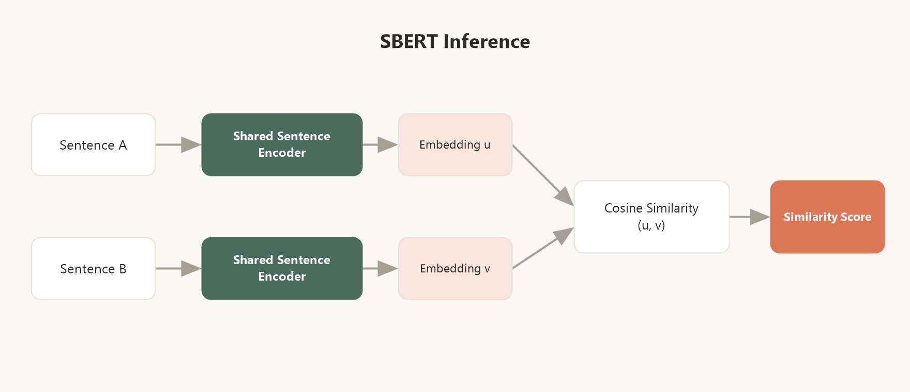

# 論文基本資訊 (MetaData)
- **Title:** Sentence-BERT: Sentence Embeddings using Siamese BERT-Networks
- **Authors:** Nils Reimers, Iryna Gurevych (Ubiquitous Knowledge Processing Lab, Department of Computer Science, Technische Universität Darmstadt)
- **Venue & Year:** Proceedings of EMNLP-IJCNLP 2019
- **Tags:** #Representation Learning, #Sentence Embeddings, #Siamese Networks, #NLP
- **Date Added:** 2026-11-16
- **Last Modified:** 2026-11-16
- **Paper Link:**
- **Code Link:** https://github.com/UKPLab/sentence-transformers

---

## 1. 核心重點摘要 (TL;DR)
* **核心價值：** Sentence-BERT (SBERT) 將預訓練 BERT / RoBERTa 改造成能獨立編碼句子的孿生或三元網路，產生可用 cosine similarity 比較的語義向量。這避免了 BERT cross-encoder 對每一組句子都要重新推論的計算瓶頸，讓語義搜尋與聚類更容易擴展。
* **主要貢獻：**
  1. 以共享權重的 siamese / triplet network 微調 BERT / RoBERTa，建立固定長度的句向量。
  2. 在 NLI、STS 與其他句向量基準上評估不同訓練目標，並分析 pooling 和向量組合方式的影響。
  3. 展示先離線計算句向量、再使用 cosine similarity 可大幅減少大量句子比對所需的推論次數。

## 2. 研究動機與背景 (Motivation & Background)
* **現有痛點：** BERT 在句對分類或回歸任務表現良好，但 cross-encoder 必須把兩句一起輸入模型。若要在 10,000 個句子中找出最相似句對，論文估算需約 5,000 萬次推論，當時約需 65 小時。直接平均 BERT 輸出或使用 `[CLS]` 向量也未必能產生適合 cosine similarity 的句向量。
* **核心洞察 (Key Insight)：** 先把每個句子分別映射成固定長度向量，再用 cosine similarity 比較，便能將昂貴的交互式句對推論改成可重用的句向量計算。透過 siamese / triplet 結構微調預訓練模型，可讓向量空間符合語義相似度需求。

## 3. 核心方法與架構 (Methodology)
* **句向量與 pooling：** 在 BERT / RoBERTa 輸出上加入 pooling，論文比較 `[CLS]`、所有 token 向量的平均值 (MEAN) 與 max-over-time (MAX)；預設使用 MEAN。
* **共享編碼器：** siamese / triplet 網路的分支共用模型權重，將各輸入句獨立編碼成向量，訓練時依資料型態選擇目標：
  * **分類目標：** 將兩句向量 `u`、`v` 與逐元素差 `|u-v|` 串接後輸入 softmax 分類器，以 cross-entropy 訓練；論文在 NLI 資料上使用此設定。
  * **回歸目標：** 以兩句向量的 cosine similarity 預測相似度，使用 mean-squared error；適用於有相似度分數的資料。
  * **Triplet 目標：** 讓 anchor-positive 的距離比 anchor-negative 至少近一個 margin；論文使用 Euclidean distance，margin 設為 1。

> **圖 1：** 分類訓練時，兩個句子經共享權重的編碼器與 pooling 轉成向量，再組合 `u`、`v`、`|u-v|` 進行分類；依據原論文 Figure 1 的方法描述重繪。

* **推論與檢索：** 推論時，句子各自編碼一次後即可用 cosine similarity 排序；同一批句向量可重複用於不同的相似度查詢或聚類工作。

> **圖 2：** 推論時分別取得兩個句向量，再以 cosine similarity 計分；依據原論文 Figure 2 的方法描述重繪。

* **訓練設定：** NLI 訓練結合 SNLI（約 570,000 對）與 MultiNLI（約 430,000 對），以三分類目標微調一個 epoch；論文採用 batch size 16、Adam、learning rate `2e-5`，並對前 10% 訓練資料線性 warm-up。

## 4. 實驗與評估 (Experiments)
* **評估基準與資料集：**
  * STS-12 至 STS-16、STS Benchmark (STSb)、SICK-Relatedness (SICK-R)，以句向量 cosine similarity 與人工標註計算 Spearman 相關。
  * Argument Facet Similarity (AFS)，包含槍枝管制、同性婚姻、死刑等議題的論證句對，評估 10-fold 與跨主題設定。
  * Wikipedia Sections Distinction 的弱標記 triplets，以及 SentEval 句向量轉移任務。
* **關鍵實驗發現：**
  * 在不使用 STS 專用訓練資料的 STS 評估中，SBERT-NLI-large 的平均 Spearman 分數為 76.55；表 1 的 Universal Sentence Encoder 為 71.22，InferSent 為 65.01。SBERT 在 SICK-R 上則低於 Universal Sentence Encoder。
  * STS Benchmark 測試集上，SBERT-STSb-base 為 84.67 ± 0.19；若先以 NLI 微調再以 STSb 微調，SBERT-NLI-STSb-base 為 85.35 ± 0.17。該表中的 BERT cross-encoder 結果更高，顯示獨立句向量的效率與句對模型的表現需一併衡量。
  * AFS 的跨主題測試中，SBERT 比相應 BERT cross-encoder 低約 6.6–7.2 個 Spearman 點；作者指出未見主題的論證語義較難只靠獨立向量捕捉。
  * Wikipedia triplet 測試中，SBERT-WikiSec-base / large accuracy 分別為 0.8042 / 0.8078，高於表列 Dor et al. 的 0.74。
  * 計算效率測試中，10,000 句的最相似句對搜尋由約 65 小時降至約 5 秒計算句向量，再加約 0.01 秒 cosine 比較。特定硬體測試中，smart batching 使 SBERT-base GPU 吞吐量達每秒 2,042 句；數值依論文所用硬體與實作而定。

## 5. 侷限性與未來展望 (Limitations & Future Work)
* **侷限性：**
  * SBERT 在 AFS 跨主題測試落後 cross-encoder，顯示當相似度取決於細粒度逐詞對照或未見主題的推理時，預先產生的單句向量可能不足。
  * BERT 的 Transformer 編碼在 CPU 上比 InferSent 的單層 BiLSTM 慢；論文指出 SBERT 的優勢較能在 GPU 及 smart batching 等設定中發揮。
  * 監督式 SBERT 的效果依賴訓練資料與目標任務；論文也指出 Universal Sentence Encoder 在 SICK-R 的資料領域上較合適。
* **未來展望：** 論文未設獨立的 Future Work 章節。依其跨主題 AFS 結果，可進一步研究如何提升句向量對未見領域的泛化；依計算效率分析，也可繼續探索不同硬體與 batching 條件下的品質、延遲與吞吐量取捨。這些是由本文結果延伸的研究方向，非作者明確列出的未來工作。

## 6. 相關工作 (Related Work)
* **BERT / RoBERTa cross-encoder：** 直接聯合編碼句對，適合句對分類或回歸，但每組候選都需重新推論；SBERT 改以獨立向量支援大規模相似度搜尋。
* **直接抽取 BERT 向量：** 平均 token 輸出或直接取 `[CLS]` 不需額外訓練，但論文實驗顯示其 STS 表現不佳；SBERT 以 NLI 等監督訊號微調向量空間。
* **InferSent、Universal Sentence Encoder 等句向量方法：** 這些工作建立了句向量比較基準；SBERT 沿用 siamese 表示學習思路，將預訓練 Transformer 用於句子編碼，並透過 STS、AFS、Wikipedia triplets 和 SentEval 評估其效果。

## 7. 個人省思與啟發 (Personal Takeaways)
* **🤖 AI 初步觀察與研究切入點：** SBERT 的關鍵取捨是以可重用的獨立句向量換取檢索效率，但跨主題 AFS 的差距提醒我們，壓縮成單句向量可能遺失任務所需的細粒度關係。可探討在不回到全量 cross-encoder 成本的前提下，如何用輕量 reranker 或領域適應改善此落差。
* **✍️ 研究生手寫筆記區：** *（待補充：閱讀完 PDF 後，可在此寫下對自己論文的具體啟發）*
