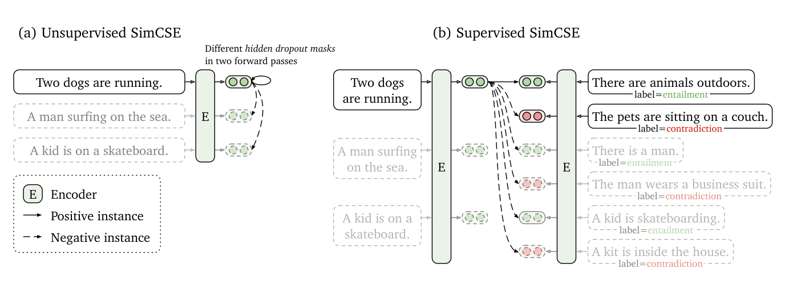

# 論文基本資訊 (MetaData)
- **Title:** SimCSE: Simple Contrastive Learning of Sentence Embeddings
- **Authors:** Tianyu Gao, Xingcheng Yao, Danqi Chen (Princeton University)
- **Venue & Year:** EMNLP 2021
- **Tags:** #Representation Learning, #Contrastive Learning, #Sentence Embeddings, #NLP
- **Date Added:** 2026-11-16
- **Last Modified:** 2026-11-16
- **Paper Link:** https://arxiv.org/abs/2104.08821
- **Code Link:** https://github.com/princeton-nlp/SimCSE

---

## 1. 核心重點摘要 (TL;DR)
* **核心價值：** 提出了一種極其簡單卻威力強大的對比學習框架（SimCSE），利用預訓練語言模型的 Dropout 作為自然的資料增強，大幅刷新了無監督與有監督句向量（Sentence Embeddings）的表現。
* **主要貢獻：**
  1. 設計無監督對比學習方法，僅將同一個句子通過帶有 Dropout 的 Transformer 兩次，將其視為正樣本對。
  2. 證明了預訓練語言模型的空間分佈存在「坍塌（Alignment & Uniformity）」問題，而對比學習能有效校正這個現象。
  3. 在多個 Semantic Textual Similarity (STS) 任務上達到當時的 SOTA，超越了許多複雜的資料增強方法。

## 2. 研究動機與背景 (Motivation & Background)
* **痛點：** 以往直接從 BERT 等 Pre-trained Language Models 抽取句向量（例如直接取 [CLS] 或是平均 pooling）的效果往往很差，甚至不如幾十年前的 GloVe 詞向量平均。過去的方法依賴複雜的資料增強（如刪除單詞、同義詞替換），但容易破壞語義。
* **核心洞察：** 作者發現預訓練 Transformer 內建的 **Dropout 機制** 本身就是一種最完美的「微擾動」。不需要改動任何架構，只要讓同一個句子餵進模型兩次（透過不同的 Dropout 遮罩），就能產生兩個完美的正樣本點。

## 3. 核心方法與架構 (Methodology)
* **無監督 SimCSE (Unsupervised SimCSE)：**
  * 給定輸入句 $x$，把它送入編碼器兩次，得到兩個不同的向量表示：$h_i = f_\theta(x)$ 與 $h_i' = f_\theta(x)$（因為 Dropout 隨機開關，兩者不相同）。
  * 優化目標為 InfoNCE 對比損失函數，拉近同一個句子的兩個 Dropout 視角，推遠不同句子的向量。
* **有監督 SimCSE (Supervised SimCSE)：**
  * 若有自然語言推斷 (NLI) 資料集，可以把 Entailment（蘊含）當作正樣本，Contradiction（矛盾）當作硬負樣本（Hard Negatives）加入對比學習。

> **圖 1：** (a) 無監督與 (b) 有監督 SimCSE 的對比學習流程。截圖自 Gao et al. (2021) 的 Figure 1，出自[論文 *SimCSE: Simple Contrastive Learning of Sentence Embeddings*](https://arxiv.org/abs/2104.08821)；依 [CC BY 4.0](https://creativecommons.org/licenses/by/4.0/) 授權。

* **💡 補充說明 (Prompt & Formatting)：** 
  * 實驗顯示，在輸入句子前後加上簡單的提示詞模板（例如 `"This sentence: {}"`）能為句向量帶來額外的語義引導，進一步提升模型在多項檢索任務上的表現。

## 4. 實驗與評估 (Experiments)
* **評估基準：** 7 個標準的 Semantic Textual Similarity (STS) 任務（從 STS-12 到 STS-18）。
* **關鍵發現：**
  * 在無監督設定下，SimCSE 在 STS 任務上平均超越以往方法顯著的幅度（Spearman's correlation 提升了 2~4 個百分點）。
  * 實驗證實對比學習優化了語向量分佈的 **Alignment（對齊性）** 與 **Uniformity（均勻性）**。

## 5. 侷限性與未來展望 (Limitations & Future Work)
* **侷限性：** 依賴強大的基礎預訓練模型（如 RoBERTa / BERT），若基底模型不好，效果也會受限；另外對比學習對 Batch Size 的大小具有一定依賴性。
* **未來展望：** 可以探索如何將此類簡單高效的表示學習擴展到多語言模型，或是結合大型語言模型（LLM）的內嵌表示。

## 6. 相關工作 (Related Work)
* 與傳統 Word2Vec、Sent2Vec 的靜態向量不同，本篇專注於利用上下文動態模型（Contextualized Embeddings）。
* 相比於先前的 Contrastive Sentence Representation 方法（如 IS-BERT、CT-BERT），SimCSE 不需要額外的語義替換模型或複雜架構，把「極簡主義」發揮到極致。

## 7. 個人省思與啟發 (Personal Takeaways)
* **研究省思：** 這篇論文給我的最大啟發是——**「最厲害的方法往往最簡單」**。大家都在絞盡腦汁想怎麼做複雜的資料增強（Data Augmentation），結果作者回頭審視模型本身的 Dropout，就挖出了金礦。做 Research 時不要總覺得非得搞得很複雜才行。
* **🚀 最新補充：** 這種利用內部 Dropout 作為微擾動的想法，其實也啟發了後續許多大型語言模型在微調時的抗過擬合策略。